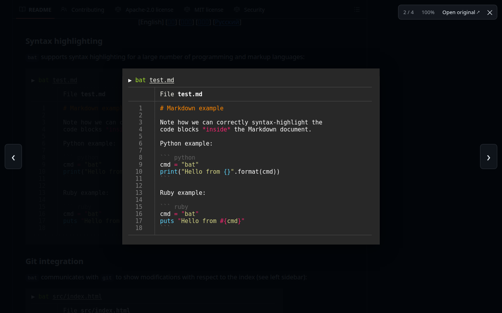

# GitHub Image Lightbox

Click an image in a GitHub readme, issue, or pull request and it opens in an in-page lightbox instead of a new tab.



- Scroll to zoom around the cursor, drag to pan, double-click for actual pixels.
- Arrow keys step through the other images in the same readme or comment.
- Esc, the close button, or a click outside the image closes it, and focus goes back to the link you clicked.
- Badges and images that link somewhere else are left alone. Ctrl-click or Cmd-click still opens a new tab.
- No network requests and no tracking. The only permission is `storage`, for the two settings.

Works in Chrome, Edge, Brave, and Firefox (Manifest V3).

## Install from source

```sh
bun install
bun run build
```

- **Chrome, Edge, Brave:** open `chrome://extensions`, turn on Developer mode, click "Load unpacked", and pick `dist/chrome`.
- **Firefox:** open `about:debugging#/runtime/this-firefox`, click "Load Temporary Add-on", and pick `dist/firefox/manifest.json`.

The build also writes store-ready zips to `dist/`, plus a source zip for Firefox add-on review.

## Keys

| Key | Does |
| --- | --- |
| `←` `→` | Previous / next image |
| `+` `-` | Zoom in / out |
| `0` | Fit to window |
| `Esc` | Close |

While the lightbox is open it swallows keystrokes, so GitHub's own shortcuts (like `s` for search) don't fire behind it.

## Settings

Right-click the extension icon, then Options:

- **Wrap around:** the arrow keys go from the last image back to the first. On by default.
- **Click outside the image to close:** on by default.

## How it works

GitHub's markdown renderer wraps every image it embeds in a link to that same image. The link's URL is either identical to the image's or is its `/blob/` page where the image is `/raw/`. The content script adds one capturing click listener to the document, so it keeps working as GitHub swaps pages without reloading. It only takes over clicks on those self-links. Images 40px tall or less (badges, emoji) are skipped.

The lightbox lives in a shadow root attached outside `<body>`, so GitHub's CSS can't reach it. Setting `body.inert` while it's open keeps keyboard focus and screen readers inside the lightbox.

```
src/content.ts    finds image links, collects the gallery, opens the lightbox
src/links.ts      decides whether a link points at the image it wraps
src/view.ts       zoom, pan, and fit math (pure functions)
src/lightbox.ts   the overlay: rendering, pointer, wheel, and keyboard handling
src/options.*     settings page
scripts/build.ts  Chrome and Firefox builds plus zips
```

## Development

```sh
bun run check   # typecheck, unit tests, then an end-to-end run in Chromium
```

The unit tests cover URL matching and the zoom math. The end-to-end test loads `dist/chrome` into Chromium and drives it on a page served at a github.com URL with GitHub's readme markup. It checks opening, arrow keys, wheel and double-click zoom, dragging, closing, focus return, and that badges and modifier-clicks are left alone.

`node scripts/demo.mjs [url]` opens a live GitHub page with the extension and regenerates the screenshots in `docs/`. The screenshot above shows the [sharkdp/bat](https://github.com/sharkdp/bat) readme.

## License

MIT
